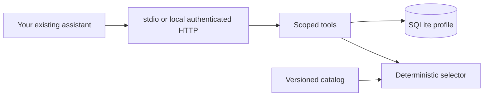

# Repertorio

**Bring what you know to the AI assistant you already learn with.**

Repertorio is a local MCP server that gives an assistant access to your repertoire, activity evidence and familiar examples. Correct something once; the next authorized session uses the corrected profile. Your assistant conducts the lesson. Repertorio supplies persistent, structured context with explicit limits.

[Get started](#get-started) · [Guia em português](docs/quickstart.pt-BR.md) · [Download v0.1.0](https://github.com/kayammaori2-afk/repertorio/releases/tag/v0.1.0) · [Evidence](docs/verification.md) · [MIT license](LICENSE)

No separate chat interface. No LLM API key, embedding service or cloud account required by the server. Your chosen assistant has its own access requirements.

## See the behavior

The included demo uses real MCP subprocesses and a synthetic profile:

| Step | What happens |
|---|---|
| Register | Save familiarity with shopping budgets, prices and alternatives. |
| Explain | Request `opportunity_cost`; receive `oc-shopping`, its limitation and a transfer question. |
| Practice | Record a synthetic activity result with the help received and its provenance. |
| Return | Restart the server and read the persisted profile. |
| Correct | Set familiarity to zero using the observed revision. |
| Adapt | Receive a direct-teaching fallback because that reference is no longer eligible. |

This sequence also worked across two actual hosts: **Claude Code created the profile; Codex read and corrected it**. See the [sanitized calls](docs/compatibility.md). This is evidence of continuity, not a learning-outcome experiment.

## Get started

Install [Python 3.13](https://www.python.org/downloads/) and [uv](https://docs.astral.sh/uv/getting-started/installation/), then run:

```sh
git clone https://github.com/kayammaori2-afk/repertorio.git
cd repertorio
uv sync --locked
uv run repertorio doctor
uv run repertorio demo
```

The bare `demo` command uses a temporary synthetic database and is safe to repeat. It opens two server processes in sequence, checks persistence and prints actual tool calls and results. It does not populate your normal profile.

To keep a demo transcript and database, choose fresh paths and an empty profile:

```sh
uv run repertorio --db demo.sqlite3 --profile demo demo --output demo-transcript.json
```

For a package-only installation, download the wheel from the [release](https://github.com/kayammaori2-afk/repertorio/releases/tag/v0.1.0), install it with `python -m pip install PATH_TO_WHEEL`, then run `repertorio doctor` and `repertorio demo`. The lockfile pins the complete tested environment; the wheel pins direct dependencies. PyPI publication is not part of this release.

## Connect an assistant

1. Run `uv run python -c "import sys; print(sys.executable)"` to find your Python executable.
2. Use its **absolute path** as the MCP command, with the arguments below. Choose an absolute private database path.
3. Copy the [session instruction](docs/tutor-instructions.pt-BR.md) into your assistant's instructions or conversation. Keep the host's tool approvals enabled.

```text
-m repertorio --db ABSOLUTE_PRIVATE_DATABASE_PATH --profile student serve
```

| Host | Configuration | Verification |
|---|---|---|
| Claude Code | [MCP JSON](examples/claude.mcp.json) | Actual create/read/context flow executed |
| Codex | [TOML configuration](examples/codex.config.toml) | Actual continuity, correction and fallback executed |
| VS Code / Copilot | [Workspace MCP JSON](examples/vscode.mcp.json) | Configuration provided; host flow unobserved |

Replace the placeholders. Windows uses `.venv/Scripts/python.exe`; Linux/macOS use `.venv/bin/python`. Both assistants must use the same database path and profile to share continuity. `doctor` shows the default data location if you omit `--db`. Use different profiles for people who should not share records.

Try this request after connecting:

> Register that I understand shopping budgets, prices and alternatives. Use `everyday:shopping`, confirm my familiarity, then help me understand `opportunity_cost` with an example and its limitation.

The initial catalog contains **16 original mappings across four concept IDs**: `opportunity_cost`, `marginal_analysis`, `conditional_probability` and `independence`. It uses explicit repertoire IDs and confirmed elements. Adding an arbitrary film or book does not automatically create a reviewed pedagogical mapping. Unsupported concepts or unsuitable references return a fallback so the assistant can continue teaching directly.

### Tool reference

| Need | Tool |
|---|---|
| Read current records and provenance | `get_profile` |
| Register or correct familiarity, progress and preferences | `save_item` |
| Get eligible mappings, reasons, limitations and fallback | `prepare_context` |
| Record an activity result or reported context use | `record_evidence`, `record_session` |
| Move a profile between installations | `export_profile`, `import_profile` |
| Review and execute authorized deletion | `prepare_delete`, `confirm_delete` |

Mutations use opaque request IDs for retries. Corrections require the current revision. Conflicting edits fail instead of silently replacing newer information. Delivery and reported use are distinct; neither a positive reaction nor one correct answer is treated as durable mastery.

## Local HTTP and data controls

stdio is the default. Optional Streamable HTTP binds only to loopback and authenticates every protected request. Generate credentials into a private directory:

```sh
uv run repertorio --profile student init-token --credentials-file PRIVATE_DIR/credentials.json --token-file PRIVATE_DIR/bearer.txt --scopes read write
uv run repertorio serve --transport http --credentials-file PRIVATE_DIR/credentials.json --host 127.0.0.1 --port 8765
```

The endpoint is `http://127.0.0.1:8765/mcp`. Configure a trusted client to read the token file and send a Bearer header. Keep tokens out of prompts, shell arguments and source control. The server reloads its hashed registry on each request; remove an old credential entry to revoke it. Profile and scopes come from the credential, never the model's arguments. [Transport details and ChatGPT's separate remote requirements](docs/compatibility.md).

Choose a private directory outside the checkout for `PRIVATE_DIR`. Export a logical backup or a readable snapshot for an assistant without MCP:

```sh
uv run repertorio --profile student export --output PRIVATE_DIR/profile.json
uv run repertorio --profile student export --format summary --output PRIVATE_DIR/context.txt
uv run repertorio --profile restored import --input PRIVATE_DIR/profile.json
uv run repertorio --profile restored import --input PRIVATE_DIR/profile.json --apply
```

Import previews first, validates the whole payload and deduplicates identical records. JSON preserves the complete profile; [CSV supports repertoire](docs/data.md). Deletion is disabled unless granted and requires a scoped, expiring preview confirmation. Deleted payloads are removed from active records; anti-replay markers, external backups and host conversations have separate retention limits.

The database is local, but your host may send returned context to its model provider. A process with the same filesystem permissions can read the database. [Security and privacy](SECURITY.md) · [Backup, restore and deletion](docs/data.md).

## Reproduce the checks

```sh
uv run python scripts/verify.py
uv run repertorio evaluate --output evidence/evaluation
uv run repertorio pilot --output evidence/pilot
uv build
```

The verification command runs lint, types, tests, the offline selector evaluation and artificial pilot analysis, and exits nonzero on failure. Release preparation passed **131 local tests**, real stdio/HTTP flows, an independent Inspector client, and installation outside the source tree. The [verification record](docs/verification.md) identifies exact environments and limits. The [manual CI workflow](.github/workflows/checks.yml) targets Windows and Linux with standard runners; no automatic push/PR trigger is configured.

### What the experiment says

The benchmark compares no repertoire (A), favorites (B), the full selector (C), and a same-candidate tag baseline (D). It contains 31 internally authored synthetic cases, including 25 with applicable ranking metrics.

**The fixed-order held-out result is negative:** C−B is **−0.05031 nDCG@3** across 12 cases. Symmetric random-tie diagnostics change it to **+0.15140**. Even the sign depends on tie order. Labels share an author with the catalog, and variants are dependent. These results do not establish general superiority or human learning benefit.

The [evaluation report](evidence/evaluation/REPORT.md) preserves negative cases, denominators and post-result changes. The [adult pilot protocol](docs/pilot.md) includes artificial data to exercise analysis; it has not recruited participants or received expert validation.

## Project map and contributing



[Architecture](docs/architecture.md) · [Data contract](docs/data.md) · [Contribution guide](CONTRIBUTING.md) · [AI and owner contributions](docs/contribution.md) · [Changelog](CHANGELOG.md)

Useful contributions include reproducible bug reports, independently reviewed mappings and cases that challenge the selector. Use synthetic data in issues. Report vulnerabilities through [private reporting](https://github.com/kayammaori2-afk/repertorio/security/advisories/new).

## License

[MIT](LICENSE) covers the project code, documentation and original bundled examples/data. Dependencies keep their own licenses; see the [license scope](LICENSE-DECISION.md) and [dependency inventory](evidence/dependency-licenses.json). User profiles are not project fixtures and are not licensed or published by this repository.
