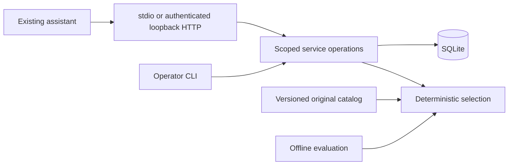

# Architecture

Repertorio supplies structured pedagogical context to a host assistant. The host owns teaching and language generation. The local service owns persisted repertoire, provenance, deterministic selection and tool contracts. It requires no language model key.

The Python package separates typed validation and storage from selection, transports and evaluation. SQLite transactions and compare-and-swap revisions protect concurrent updates. Idempotency keys bind to operation payloads within an identity. Retrying an operation with different content is a conflict. Import validates the complete payload before changing the database. Export preserves record provenance and excludes credentials.

The installed official SDK is MCP 1.30.0. This release intentionally targets the protocol versions actually supported by that SDK and the observed clients. The newer MCP specification published on the documentation site is not assumed implemented. See the observed protocol and host matrix in compatibility.md. The lockfile records the complete dependency resolution.

HTTP is an opt-in local transport. A server-side token configuration binds a bearer credential to a profile and scopes. stdio derives identity and permissions from launch configuration. The model never supplies an authorization identity. Local host processes share the operator's trust boundary. Remote hosting and OAuth deployment require a separate deployment design and authorization.

The pedagogical catalog contains original hypothetical experiences. Selection uses explicit familiarity and conceptual correspondence, with exclusion and spoiler filters applied first. Scores have policy units. Results include limitations and fallback guidance. A caller can provide task metadata, but cannot promote its own evidence into independently verified mastery.

The relevant user surface is the conversation and tool response. Persistence must be truthful: report success only after commit, explain conflicts, and preserve continuity across a return to another session. Errors, retry, correction, export and return are tested behaviors. No visual surface is part of this release.

## Sources checked during implementation

- Official Python SDK and API source installed in the environment, https://github.com/modelcontextprotocol/python-sdk
- Protocol specification, https://modelcontextprotocol.io/specification/latest
